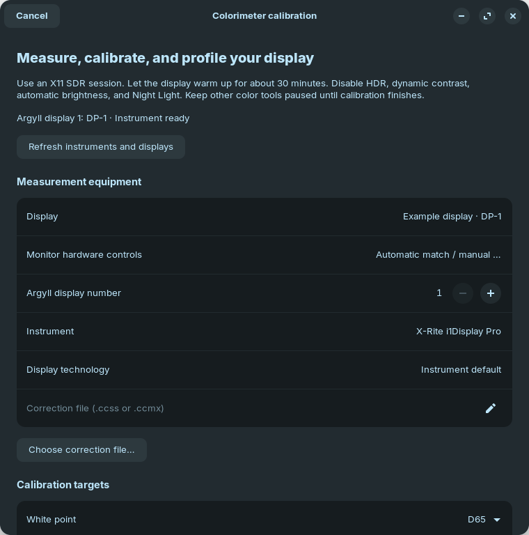
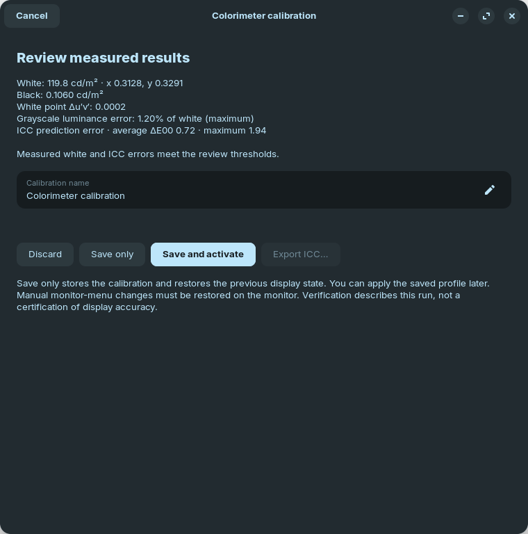

# Colorimeter calibration

Open **Main menu → Colorimeter…** from guided calibration or live controls.
This workflow measures an SDR display in a local X11 session. It can work
without DDC controls, including on laptop displays. XWayland is not a
compositor calibration path; Wayland and HDR calibration are not supported.

## Dependencies

Install your distribution’s **ArgyllCMS** package, including `spotread`,
`dispcal`, `targen`, `dispread`, `colprof`, `profcheck`, and `dispwin`.
Instrument support depends on the installed Argyll version. Use a current
release for newer instruments. No Argyll executable is bundled with Lumen.

ICC activation additionally needs **colord** and **dbus-python**. The optional
Python extra is `python3 -m pip install -e '.[gui,x11,colorimeter]'`; your
system package manager may supply dbus-python instead. GTK4/libadwaita and
ArgyllCMS remain system dependencies. `lumenctl doctor` reports availability.

USB instruments need your distribution’s color-measurement udev rules.
If discovery reports permission errors, install the distribution’s Argyll
instrument rules and reconnect the instrument. Do not run Lumen as root.
Some instruments require separately obtained vendor calibration data;
Lumen does not download firmware or corrections automatically. See the
[Argyll Linux installation guide](https://www.argyllcms.com/doc/Installing_Linux.html).

Opening Settings does not discover instruments or change hardware.
**Colorimeter → Check instruments and dependencies** performs an explicit
check. The wizard’s Refresh action rediscovers devices.

## Prepare and select equipment

Warm up the display for about 30 minutes. Disable HDR, dynamic contrast,
automatic brightness, Night Light, and other gamma tools. Use stable room
lighting and keep the sensor flat against the panel. Follow instrument
calibration instructions when requested.

Select the output and instrument. Check the Argyll display number against
the discovered list. Lumen only automatically pairs DDC controls when EDID
or a complete connector identity matches. Otherwise select the hardware
monitor explicitly, or leave it unpaired and use its menu. Mirrored outputs
share gamma hardware and must be separated before calibrating.

Select a display technology actually offered by the instrument. The default
uses the instrument’s own default calibration; it is not a claim that Lumen
identified the panel’s backlight spectrum. An optional local `.ccss` or
`.ccmx` file overrides the instrument’s correction. Use a correction suitable
for both the instrument and the display.

## Targets and measurement

Defaults are D65 white, 120 cd/m², gamma 2.2, Quick mode, and automatic DDC
adjustment. Settings also offer D50, native white, custom daylight
4000–10000 K, luminance 50–400 cd/m², gamma 1.6–2.6, and sRGB response.
Each run can override these defaults.

Lumen captures the controls it may change and all three gamma ramps, checks
instrument access, then establishes a linear measurement baseline. When
available, brightness is optimized by bounded bisection and RGB gains by
coordinate descent, for at most eight sweeps. The goal is luminance within
3% and white-point distance within 0.003 in CIE 1976 u′v′. Later search
trials cannot replace an earlier, better joint hardware setting. Contrast,
black levels, presets, saturation, and dangerous VCPs are not adjusted.

Missing or unreliable controls lead to live readings and monitor-menu
instructions. Choose Measure again after each manual adjustment. Settings
changed in the monitor’s menu cannot be captured, restored, or reapplied by
Lumen; record them yourself. If the requested targets are unreachable,
continue explicitly with the achieved baseline or cancel and revise targets.

ArgyllCMS then measures and fits per-channel calibration curves:

- **Quick** uses low-quality iterative calibration and integrated
  matrix/shaper ICC characterization.
- **Detailed** uses high-quality calibration, a 729-patch profiling chart,
  and an XYZ LUT ICC profile with a matrix fallback for applications that
  do not support LUT display profiles. It takes substantially longer.

The resulting ICC contains a `vcgt` calibration tag. The same absolute
sampled curves are saved in the Lumen profile; they are not approximated
with an exponent or multiplied into the currently installed ramp.

## Review, save, and activate

Verification uses an independent 51-patch chart: 21 neutral levels, six
primaries/secondaries, and 24 fixed interior colors. The report contains
white luminance/chromaticity, black luminance, grayscale response, and
CIEDE2000 ICC prediction errors. White-target deviations and errors above
average ΔE00 2 or maximum ΔE00 5 require an explicit keep choice.
These are review thresholds, not a certification. ICC prediction error
measures characterization quality; it does not mean every application’s
output has been converted to sRGB or another reference gamut.

- **Save and activate** saves the calibration, registers its ICC with colord,
  makes it the selected display’s default, publishes its X11 ICC property,
  and applies verified RGB ramps. It also selects the saved Lumen profile
  as the login/wake default, so the service will not restore an older curve.
- **Save only** stores the files and restores the prior display state.
- **Discard** restores the prior display state and removes temporary files.

An activation failure keeps the saved files and offers retry or ICC export.
The previous ICC association is restored after partial activation. Manual
monitor-menu changes still need manual restoration.

Profiles have unique filenames under `$XDG_CONFIG_HOME/lumen/profiles`.
Their `.cal`, `.icc`, verification measurements, diagnostic transcript, and
JSON report live under `$XDG_CONFIG_HOME/lumen/calibrations/<id>`.
Saved names do not replace existing calibrations. Export copies the ICC;
the profile’s JSON report remains in its calibration directory.

Select a saved measured profile in Settings → Profiles to make it the
login/wake default. The GUI, CLI, and service resolve the saved display by
identity rather than output order. A missing or ambiguous display is refused.
Without EDID, the recorded connector and monitor identity must still match.
The service does not automatically start or enable itself.

## Ownership and failure recovery

During a run, a process-safe lock prevents Lumen’s controls, CLI, and service
from changing the same display. colord profile matching and display sleep
are temporarily inhibited where available. The originating window is
suspended. Cancelling stops Argyll and its process group before restoration;
restoration failures are reported. A forced process termination or machine
power failure cannot run this cleanup.

After activation, desktop color management may load the ICC’s `vcgt` and
Lumen may reapply those same absolute curves at login/wake. Lumen does not
start a competing continuous gamma loader. Third-party Night Light and
other color tools can still replace the calibration; pause those tools
when assessing accuracy. Lumen’s existing Night Light preference only
manages GNOME’s automatic schedule, not every color adjustment.

Hardware validation is opt-in. The automated suite uses fake displays,
process fixtures, and simulated colord. Before claiming a particular device
works, record its model, display model, X11 desktop, Argyll version, Quick
and Detailed results, cancellation behavior, and login/wake reapplication.
